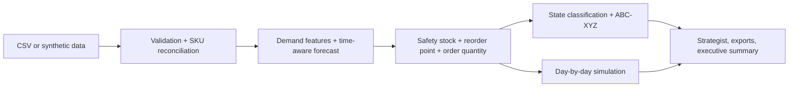

# STOCKWISE AI — Retail Inventory Intelligence
The right stock. At the right time.

Connects demand forecasts to explainable replenishment decisions, excess-stock actions and scenario comparisons for a retailer with stock-outs on fast movers and excess on slow movers. Bundled data is **fictional synthetic data** (78 SKUs, 6 categories, 8 suppliers, 24 months of daily sales).

## Architecture


## Run
```
pip install -r requirements.txt
python app.py
```
In Google Colab paste `app.py` into one cell. The `src/` modules in the brief are consolidated into `app.py`.

## Tests and limits
`pip install pytest && pytest tests` runs the built-in self-tests. See `docs/`. Not included: LP optimiser, PDF, expiry modelling. Estimates are not guarantees; buyers must review. Screenshots: add yours to `screenshots/` (none included).
